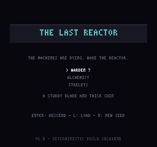
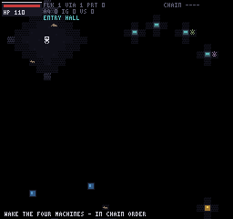
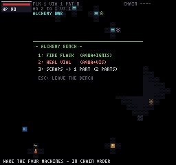
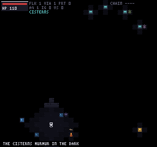
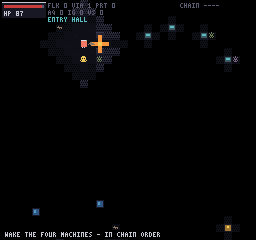
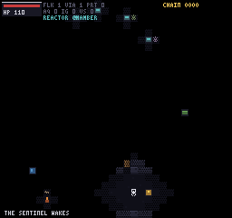
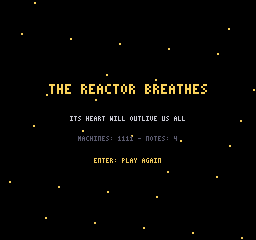

# The Last Reactor

A tiny, fully deterministic top-down action game about waking the last reactor
of a dying machine city. Zero dependencies, zero build step, zero external
assets: open `index.html` and play. Everything — world, art, sound — is
generated by code from a seeded LCG.









## Story

You are the last keeper. The four great machines have fallen silent and the
reactor sleeps at the heart of the complex. Wake the machines **in chain
order**, trade with what is left of the Keeper's guild, brew fire in the
alchemy lab — and take back the reactor chamber from the Sentinel that nests
there.

## Controls

| Key | Action |
| --- | --- |
| Arrows / WASD | Move (4 directions, sets facing) |
| J / Space | Attack (class attack) |
| K / E | Interact / use (machines, cisterns, geyser, bench, doors, merchant, reactor). With nothing adjacent: drink a healing vial |
| I | Satchel (inventory) |
| O | Recovered notes |
| 1 / 2 / 3 | Alchemy bench recipes |
| P | Pause (S while paused saves) |
| Esc | Close dialog → choice → panel → toggle pause |
| Enter | Confirm (title / restart) |

## Mechanics

- **Deterministic world.** Every random decision goes through a seeded LCG
  (`TLR.setSeed`). Same seed ⇒ same world, same spawns, same behaviour. No
  `Math.random`, no dates, no timers inside the simulation.
- **Machine chain.** The four machines must be woken in order 1→2→3→4. Each
  one yields a VIS reagent, a lore note and +1 light radius. The full chain
  unseals the gate to the reactor chamber.
- **Alchemy.** Cisterns give AQUA, the energy geyser gives IGNIS, machines
  give VIS. At the bench: AQUA+IGNIS ⇒ fire flask, AQUA+VIS ⇒ healing vial.
- **Three classes.** Warden (melee slash, 110 HP), Alchemist (throws fire
  flasks with an area blast, 90 HP), Strelets (long-range bolts, 80 HP).
- **Six enemies.** Rats, ghouls, strelets (ranged, keeps distance), trolls
  (lob firebombs that detonate on contact or timeout), wraiths (phase through
  walls), and the Sentinel boss (charges, triple-shot spreads).
- **Passage doors.** Two teleports link the alchemy lab and the cisterns;
  a 24-frame cooldown prevents ping-pong teleporting.
- **Darkness.** A dithered light radius follows the player and the machines
  glow on their own. Light grows as the chain comes alive.
- **Merchant.** Trade machine parts (dropped by killed enemies) for flasks
  and vials.
- **Saving.** Progress persists in `localStorage` (pause menu → S), with an
  in-memory fallback when storage is unavailable.

## Architecture

Plain ES5 modules, no bundler, no framework:

```
index.html            - canvas + script includes
js/core.js            - namespace, seeded LCG, shared state, 3x5 bitmap font
js/assets.js          - procedural palette, tiles, sprites (code-drawn)
js/audio.js           - WebAudio square-wave beeps (silent no-op headless)
js/world.js           - district generator, doors, landmarks, BFS helpers
js/entities.js        - enemy defs, per-kind AI, projectiles, explosions
js/player.js          - movement, class attacks, interactions, merchant
js/save.js            - localStorage save/load with memory fallback
js/ui.js              - HUD, satchel, alchemy, notes, pause, dialogs, title
js/render.js          - camera, tiles, dithered darkness, scene rendering
js/main.js            - input dispatch (Escape layering), game loop, TLR hooks
tests/headless.js     - 61 checks x 3 seeds + BFS connectivity audit
tests/capture-harness.js - fillRect-only rasterizer + indexed PNG encoder
docs/                 - design, architecture, testing notes + screenshots
```

The renderer only uses `fillRect`/`fillStyle`/`save`/`restore` — that single
constraint is what lets the *same renderer* run against the headless test
rasterizer (`tests/capture-harness.js`) to produce byte-stable PNG
screenshots without any DOM.

## Tech

- Language: ES5-compatible JavaScript (works in every modern browser anyway)
- Canvas 2D, 256×240 internal resolution, pixelated upscale
- WebAudio for sound (generated square waves — no audio files)
- No dependencies, no network calls, no build tools

## Build & run

Nothing to build. Either:

- open `index.html` directly in a browser, or
- serve the folder with any static server (`python -m http.server`,
  `npx http-server`, ...) and open it.

## Testing

The full suite runs without a DOM:

- `tests/headless.js` — `TLR_runHeadless()` → **183/183 checks pass**
  (61 checks × 3 seeds: 20261030, 987654321, 1357911130), and
  `TLR_auditConnectivity()` → **33/33 world targets reachable in 7 audit
  groups, on every seed**.
- In a browser you can re-run both from the console after loading the page.

What is tested, what is not, and every honest caveat is enumerated in
[docs/testing.md](docs/testing.md). The development story (including three
full rebuilds after environment resets and the bugs the suite caught) is in
[CHANGELOG.md](CHANGELOG.md). Asset provenance: [ASSETS.md](ASSETS.md).

Note on the screenshots: they are deterministic output of the game's own
capture harness and are (re)generated by a GitHub workflow
(`node tests/regen-screenshots.js`); the publishing connector used for this
repository writes UTF-8 text only.

## License

All code and content here is original and generated at runtime by that code.
No third-party assets are used or required. Do whatever you like with it.
