# The Last Reactor — історія спроб і вольових зусиль

> Цей документ навмисно українською — це робоча мова автора проєкту.
> Технічна документація репозиторію англійською; це — лірична хроніка.

Це розповідь про одну гру, три повні збірки з нуля, три збої середовища,
один пошкоджений бінарник на відстані 6 178 кілометрів і про те, чому
детермінізм — найкращий друг того, хто не любить брехати.

---

## Хронологія

```mermaid
graph LR
    A["Місія: 7 правил"] --> B["Збірка 1: гра написана"]
    B --> X1["💥 Збіг середовища №1"]
    X1 --> C["Збірка 2: відбудова"]
    C --> D["01-title.png байт-точний 61778 б"]
    D --> E["Спроба публікації — результат невідомий"]
    E --> X2["💥 Збіг середовища №2"]
    X2 --> F["Сесія 3: перевірка"]
    F --> G["Репозиторій порожній?!"]
    G --> X3["💥 Збіг середовища №3 — файли зникли"]
    X3 --> H["Збірка 3: з нуля, за описом"]
    H --> I["183/183 тестів · аудит 33/33"]
    I --> J["Публікація: PNG пошкоджено +20 б"]
    J --> K["Рішення: GitHub Actions генерує PNG"]
    K --> L["✅ blob SHA 7/7 — байт-точно"]
```



---

## Акт перший. Місія і сім правил

Завдання звучало просто: доправити гру **The Last Reactor** до завершення і
опублікувати на GitHub у репозиторій `Skalagrimmo/the-last-reactor`. Але до
нього додавалися правила, і саме вони згодом визначили увесь масштаб драми:

1. перевірити корінь проєкту;
2. окремий репозиторій або гілка — і **ніколи** не чіпати
   `the-last-reactor-android`;
3. повні джерела, асети й тести;
4. README з архітектурою, технологіями, керуванням, механіками,
   збіркою та запуском;
5. чесний звіт про тестування;
6. `.gitignore`, без кешів і секретів;
7. не переписувати й не спрощувати готову реалізацію;
8. без комерційних асетів.

І головне, невимовлене вголос, але найважливіше: **жодних заяв про успіх,
доки факт не підтверджено на самому GitHub**. Це правило вселило в історію
головну сцену.

## Акт другий. Три збої

Гра — маленький детермінований бойовик про останнього сторожа машинного
міста: ES5, десять модулів, нуль залежностей, весь світ — з сіда LCG, вся
графіка — `fillRect`-ами, весь звук — квадратні хвилі WebAudio. Збірка 1
була написана, прогнана і вже майже вручена.

**Бум.** Збіг середовища №1: робоча тека зникла. Джерел ніде немає —
ні у файловій системі, ні в бібліотеці завантажень, ні в канвасах.
Відбудова з нуля за тим, що лишилося в пам'яті розмови. Збірка 2
вийшла навіть сильнішою: тестовий пакет 54×3 сіда, безголовний
растеризатор, власний PNG-енкодер. А її коронним номером стала
**байт-точна репродукція `01-title.png`** — 61 778 байтів, ідентичний
git-blob SHA `86b970546cf2ffc0434e18cd52b18779e4723f77`. Це був не скріншот,
це був **доказ вірності** відбудови.

Потім — публікація: bootstrap репозиторію, пуш 19 текстових файлів, сім
PNG окремими комітами. Код драйвера пройшов весь шлях… а результат
виклику «зберігся за межами звіту». Кажуть, у діалогу сесій на це
кладуть особливий зміст.

**Бум.** Збіг середовища №2 — знову чиста файлова система. Далі слово
новій сесії.

## Акт третій. «Продовж з зупинки»

Крок перший, згідно з протоколом: **не вірити, а перевірити**.
`get_file_contents` на репозиторій… і GitHub відповідає крижаним
`409: Git Repository is empty`. Репозиторій порожній. Всі ті коміти
«пройшли шлях» — але не залишили жодного байта. Драматична іронія:
правило «не заявляй, поки не перевіриш» спрацювало саме так, як
замислювалося. Не було жодної хибної заяви про успіх.

Але справжній удар чекав локально: `/home/user/the-last-reactor` не
існував. **Збіг №3.** Археологічна розвідка дала тільки артефакти:
дві сотні кілобайт `od`-дампів у tool-results і один витяг чату —
розповідь про побудову гри, але не сам код. Жодного шляху відновлення.

І тоді було ухвалене рішення, яке і є «вольовим зусиллям» цієї історії:
**відбудувати гру з нуля, втретє, за описом архітектури** — і з честю
задокументувати це. Пропозиція приховати чи обійти — не прозвучала ні
разу.

## Акт четвертий. Збірка 3, або як тести ловили баги

Збірка третя зіткнулася з тими самими привидами, що й попередні, — і
кількома новими:

| # | Баг | Хто зловив |
| --- | --- | --- |
| 1 | Коридор до алхімічної лабораторії прокладено при x=32, а машинний зал закінчується на x=29 — лабораторія була **відрізана від світу** | аудит BFS (6 недосяжних цілей) |
| 2 | Бекенд збереження створювався на кожен виклик — save і load писали у різні «сховища» | тест P04 |
| 3 | Індекси пріоритету погоні переплутані у вертикальній гілці — моби **тікали**, коли гравець стояв над ними | тест C12 |
| 4 | Погляд не скидав другу вісь: після руху вниз атака летіла вбік (той самий привид `(player.fx \|\| 1)`) | тест C04 |
| 5 | PNG-енкодер писав довжини чанків та Adler-32 little-endian — файл не відкрився б жодним переглядачем | +8 байт зайвих до розміру |

Прогрес тестів читався як сюжет: **162/183 → 177/183 → 183/183**, і на
кожному сіді (20261030, 987654321, 1357911130) — ідентично. Аудит
зв'язності звівся до рівно 33 цілей у 7 групах — 33/33 на кожному сіді.

Курйоз на пам'ять: власна sha1-реалізація для обчислення blob-SHA «провалила»
самоперевірку — канонічний SHA-1 від «abc» у моїй константі був
надрукований у 39 символів. Тест помилився, не код. Таке теж буває.

## Акт п'ятий. Скріншоти і археологія байтів

Сім канонічних сцен, захоплених у фіксований кадр `t=120`: титул,
вхідна зала, лабораторія, кістерни, бій, бос, фінал. Розміри —
`61760 + 3×(кількість кольорів)`: 61778, 61820, 61835, 61829, 61829,
61841, 61775.

По дорозі енкодер обріс двома шрамами:

- **8 зайвих байтів.** Розмір титулу вийшов 61786, а не 61778. Замість
  гадання я пройшов чанк-волоком по файлу і знайшов: sed під час виправлення
  з'їв бекслеші в заголовку zlib, і в data-блок потрапив буквальний текст
  `"u0078u0001"` — вісім текстових символів замість двох байтів `78 01`.
- **Порядок байтів.** PNG великоважливо вимагає big-endian від довжин
  чанків, IHDR і Adler-32, і тільки deflate-ний LEN/NLEN живе
  little-endian. Мій перший `w32` писав усе навпаки.

І команда `od` без `head -c` викинула 255 кілобайтів дампу в чат —
класика. Досвід повернувся: «od ігнорує -N, обрізай head -c».

## Акт шостий. Драма публікації, або +20 байтів

Публікація пішла за планом:

- `102147f0` — bootstrap порожнього репозиторію (`index.html`),
- `9cc4de39` — 19 текстових файлів, 115 360 байтів, одним комітом,
- зонд: перший PNG бінарним рядком.

І от тут зонд повернувся з пораненням: **61 798 байтів замість 61 778**.
Git-blob SHA на GitHub не збігся. Завантажена з GitHub копія починалася
не з `89 50 4E 47`, а з `C2 89 50 4E 47` — сервер конектора трактує
рядок як текст і **кодує його в UTF-8**: кожен байт ≥ 0x80 подвоюється
префіксом `C2/C3`. Формат PNG обов'язково містить такі байти (вже
підпис `89 50 4E 47` — після `0x89` іде `0x50`, невалідна
послідовність UTF-8). Висновок холодний і остаточний:

> **Байт-точне завантаження бінарних PNG через цей конектор неможливе
> в принципі.** Не «складно», а математично: не існує рядка,
> UTF-8-кодування якого дорівнює цим байтам.

## Акт сьомий. Врятований детермінізмом

І тут згадувсяся головний дизайн-принцип гри: **весь світ — детермінований
вихід її ж коду**. Якщо PNG — це просто функція від джерел, то хіба
треба їх завантажувати? Можна їх **згенерувати на місці**.

Так народився `.github/workflows/screenshots.yml` + `tests/regen-screenshots.js`:
GitHub Actions підняв Node 20, скрипт склеїв модулі, викликав
`TLR_captureAll()`, і записав сім PNG через `Buffer.from(png, 'latin1')` —
тепер уже на своїй машині, де байти — це байти. Workflow сам закомітив
результат (`92f03a18`, автор — `github-actions[bot]`), а на очікуванні
випало хвилювання: чи ввімкнені Actions, чи не втомиться черга.

Перевірка була безжальною — так, як і належить: git-blob SHA кожного з
семи PNG на GitHub проти локально обчислених еталонів.

```
01-title.png   61778 b  b9158be0…  ✓
02-entry.png   61820 b  32bed244…  ✓
03-alchemy.png 61835 b  3a1c89bf…  ✓
04-cisterns.png 61829 b ce628a02…  ✓
05-combat.png  61829 b  06bd93bc…  ✓
06-boss.png    61841 b  955d1001…  ✓
07-ending.png  61775 b  b59a9d49…  ✓
```

**7/7. Байт-у-байт. На GitHub. Підтверджено.** Пошкоджений зондовий
`01-title.png` був перезаписаний коректним — той самий шлях, ті самі
байти, вже справжні.

## Фінал

П'ять комітів, 29 файлів, фінальний SHA
`92f03a18369046815ae96e1bbc89856b74ae477b`. Репозиторій
`the-last-reactor-android` не зачеплений — перевірено читанням, до
нього жодного разу не було жодного write-виклику.

А лишилося чесно назвати, чого **не** можна було перевірити: реальний
браузер (DOM, клавіатура, rAF), WebAudio, тач-ввід, живий localStorage,
продуктивність, і те, що жодна людина ще не бачила гру очима.
Усі пункти — у `docs/testing.md`; жоден не прихований.

## Моралі цієї історії

1. **Перевіряй, перш ніж заявити.** Один GET-запит у правильний момент
   врятував від хибного «опубліковано!» — і перетворив би всі
   подальші слова на попіл.
2. **Детермінізм — це суперсила.** Гра, що є чистою функцією від
   свіда, пережила три збійки; її скріншоти перенесли подорож
   «генерацією на місці», коли канал не брав бінарник.
3. **Тести ловлять не тільки баги коду.** Відкинута лабораторія,
   моби-втікачі, endian-привид у PNG — усі знайдені автоматикою,
   жоден — «на око».
4. **Втрати — це теж частина репозиторію.** CHANGELOG цього проєкту
   починається не з перемог, а зі слів «the uncomfortable part first».
   Історія спроб і вольових зусиль виявилася гідною документацією
   не менш, ніж сам код.

---

## Постскриптум. Збіг №4 — під час написання цієї хроніки

Поки цей файл писався, робоче середовище скинулося **вчетверте**: локальна
тека проєкту знову спорожніла — все, крім самого `journey.md`. І саме тут
стало видно, заради чого весь цей шлях було пройдено: **відбудовувати
нічого не довелося.** Гра, тести, документація і сім байт-точних
скріншотів уже жили на GitHub — з перевіреними blob SHA і комітами.
Втрата локальної копії, що тричі була катастрофою, четвертого разу
стала просто пам'ятною нотаткою в історії проєкту.

Ця хроніка опублікована окремим комітом — «docs: journey». Якщо ви
читаєте її на GitHub, отже, остання перевірка теж пройшла за всіма
правилами: спершу факт на сервері — потім слова в чаті.
